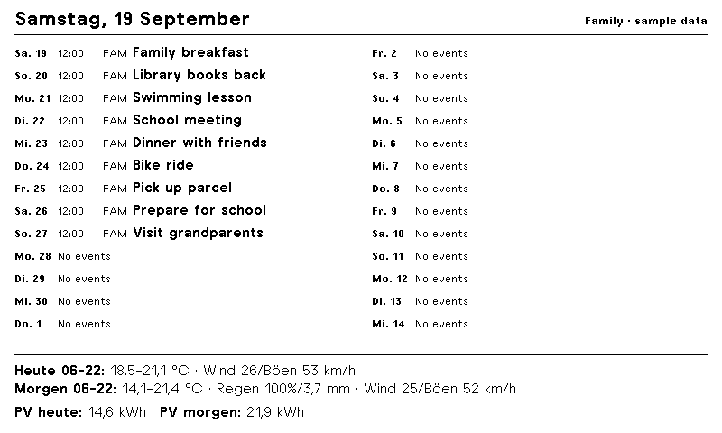
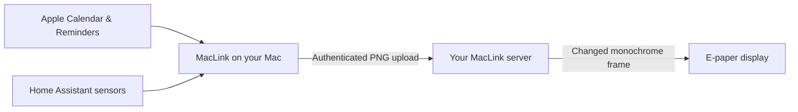

# MacLink

### Your family's day, quietly on e-paper.

MacLink turns Apple Calendar, Reminders, and Home Assistant sensors into a crisp dashboard for a 7.5-inch e-paper display. A native Mac app composes the page, a small server holds the latest image, and the display wakes to fetch changes.



*An actual 800 × 480 render using fictional appointments and sensor readings.*

## What it does

- **A shared family agenda.** Choose calendars, abbreviations, reminder lists, and sorting independently for each display. Matching events across calendars appear once.
- **Room for the whole day.** Two columns fit as many complete days as possible, with wrapping titles and a configurable lookahead of up to 31 days.
- **Useful information at the bottom.** Add up to four Home Assistant sensors or binary sensors: weather summaries, solar forecasts, battery levels, bin days, or appliance status.
- **Simple Markdown.** Enable formatting for individual sensor values or attributes. Bold emphasis and line breaks make short summaries easy to scan.
- **Built for e-paper.** Native-size TRMNL pixel fonts, monochrome emoji, and exact black-and-white output. Unchanged pixels do not trigger another refresh.
- **Control over battery use.** Configure each display's check interval and daily update window, including overnight hours and time zones.
- **Native Mac controls.** Menu-bar app, Keychain credentials, preview, launch at login, and a guided USB firmware workflow with a backup before flashing.

## How it fits together



The server retains the last image when your Mac sleeps. **New content and date changes require the Mac app to run while the Mac is awake.** Home Assistant is optional; weather is supplied through your chosen HA sensors, with no direct Apple Weather integration.

## Get started

You will need:

- A Mac running **macOS 14 or later**, with a Swift 6 toolchain to build the app.
- **Docker Compose** on a machine reachable by both the Mac and display.
- The supported **Seeed XIAO ESP32-C3, 7.5-inch monochrome 800 × 480 display** and a 2.4 GHz Wi-Fi network.
- [uv](https://docs.astral.sh/uv/) for firmware tools and development checks.
- Optionally, a Home Assistant instance and a long-lived access token.

```sh
git clone https://github.com/kmplngj/epaper-maclink.git
cd epaper-maclink
sh scripts/build-mac.sh
mkdir -p ~/Applications
ditto dist/MacLink.app ~/Applications/MacLink.app
open ~/Applications/MacLink.app
```

Then follow the **[setup guide](docs/setup.md)** to start the server, connect the app, select content, and provision the display. This is a source-built project; it does not currently provide a signed, notarized installer.

## Make the footer yours

In **Home Assistant**, connect your instance, enable **Show sensor footer**, and add your sensors. Choose a state or scalar attribute, label, unit, number of decimal places, and plain text or Markdown for each item.

For example, a text attribute can contain:

```markdown
**Today:** 18–22 °C · Rain 20% | **Tomorrow:** 16–21 °C · Bring **boots**
```

Leave its label blank, select **Markdown**, and allow two lines. Short readings share a row; longer summaries receive more width. The footer takes only the space it needs. Sampling defaults to 30 minutes and can be changed from 5 minutes to 6 hours.

Markdown is deliberately small: emphasis and link labels are rendered as text; headings, tables, HTML, images, and Home Assistant cards are not supported. See [setup and behavior](docs/setup.md#home-assistant).

## Project guide

| Path | Contents |
| --- | --- |
| [`macos/`](macos/) | SwiftUI app, EventKit integration, HAKit client, and pixel renderer |
| [`server/`](server/) | FastAPI service, SQLite storage, and delivery scheduling |
| [`firmware/`](firmware/) | GPLv3 additions compiled into OpenDisplay firmware |
| [`scripts/`](scripts/) | Build, test, deployment, and USB provisioning tools |
| [Setup](docs/setup.md) | Server, Mac app, sensors, and daily use |
| [Firmware](docs/firmware.md) | Supported hardware, backups, upstream source, and licensing |
| [Architecture](docs/architecture.md) | Rendering, delivery protocol, and storage |
| [Development](docs/development.md) | Build requirements and validation commands |

## License and acknowledgments

MacLink's **Mac app, server, documentation, and general tools are [MIT licensed](LICENSE)**. The **`firmware/` code and `scripts/build-firmware.py` are [GPLv3 licensed](firmware/LICENSE)** because they integrate with [OpenDisplay Firmware](https://github.com/OpenDisplay/Firmware). The combined firmware is not covered by the root MIT license.

Bundled fonts retain **SIL OFL 1.1**, and HAKit and Starscream retain **Apache 2.0**. Full attribution, pinned sources, and scope are in [Third-party notices](THIRD_PARTY_NOTICES.md).

Thanks to the OpenDisplay, Home Assistant, TRMNL, and Noto projects. MacLink is an independent project and is not affiliated with Apple or those projects.
